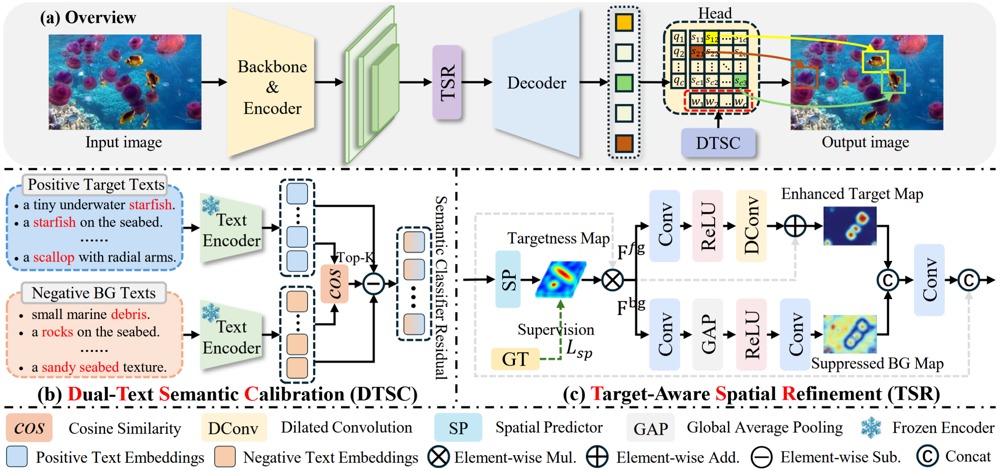

# SSDNet: Dual-Text-Guided Semantic-Spatial Decoupling

Underwater small object detection often suffers from ambiguous semantic recognition and inaccurate localization due to severe background interference and limited target representation. Existing methods mainly focus on enhancing visual representations, but still struggle to explicitly distinguish small targets from visually similar backgrounds. To address these challenges, we propose a Semantic-Spatial Decoupling Network for underwater small object detection. Specifically, we introduce a Dual-Text Semantic Calibration module, which exploits target-related texts and confusing background texts to explore category-specific semantic relationships and generate calibration directions, thereby enhancing target-background discrimination. Furthermore, we propose a Target-aware Spatial Refinement module, which learns target-aware spatial distributions from multi-scale features to enhance target responses while suppressing redundant background information. Extensive experiments demonstrate that the proposed method consistently improves detection performance over the baseline and exhibits strong robustness in complex underwater scenarios.




## Installation

```bash
conda create -n ssdnet python=3.10 -y
conda activate ssdnet
pip install -r requirements.txt
```

## Train

### DUO

```bash
python train.py -c configs/dfine/underwater/ssdnet_s_duo.yml
```

### RUOD

```bash
python train.py -c configs/dfine/underwater/ssdnet_s_ruod.yml
```

### UTDAC2020

```bash
python train.py -c configs/dfine/underwater/ssdnet_s_utdac2020.yml
```

## Acknowledgements

Thanks to [D-FINE](https://github.com/Peterande/D-FINE), [PyTorch](https://pytorch.org/), and the developers of the tools used in this project.
